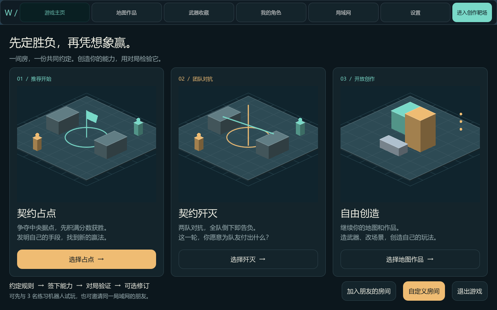
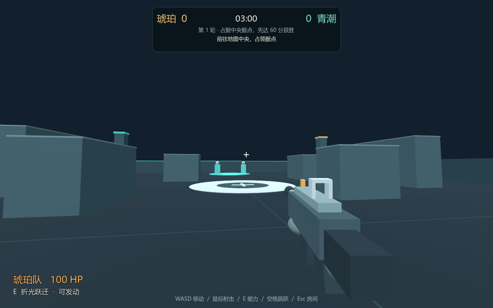

# 念造 · Wishift

**AI 创作 × 第一人称对战｜团队原型项目**

Wishift 探索“在游戏里边玩边创造”：玩家通过自然语言提出想法，由 AI 生成或调整地图、武器、技能与交互行为，再进入游戏体验和迭代。项目基于 Godot 开发，结合自由创作与有明确胜负目标的 FPS 对战。

## 核心玩法

### 自由创作

在地图内描述想要的场景或玩法变化，生成后直接试玩，并通过保存、撤销和版本恢复继续调整。创作围绕当前地图展开，角色与武器也有独立的收藏、编辑入口。

### 契约对战

围绕占点或歼灭目标，玩家先约定公共规则，再创造自己的能力。AI 协助生成能力方案，并协商发动条件、使用代价与反制方式；玩家确认后，将能力带入对局。

**约定规则 → 提出能力想法 → 确认能力与代价 → 对局验证 → 赛间修订**

这一玩法希望在创作自由与对抗体验之间建立联系：能力既要有发挥空间，也要让对手能够理解和应对。

*原型实机截图，使用基础场景与角色验证玩法。*

## 个人贡献

- **创意构思：** 作为游戏创意贡献者之一，参与游戏概念构思与原型开发。
- **运行适配：** 完成 Windows 端运行适配与功能调试，验证主要游戏流程。
- **体验优化：** 借助 AI 开发工具排查运行问题，完善界面切换与操作流程，优化镜头响应和会话恢复体验。

本项目由团队共同开发，以上为个人参与部分。

## 当前进度

- 已有可运行的占点、歼灭原型，以及单人机器人练习、游戏内创作和版本恢复流程。
- 已实现最多四人的局域网房间逻辑，并完成同机多进程联机验证；跨设备体验仍待进一步测试。
- 当前暂停迭代，尚未正式发行，美术表现与对战平衡仍处于原型验证阶段。

**技术基础：** Godot / GDScript / JavaScript
